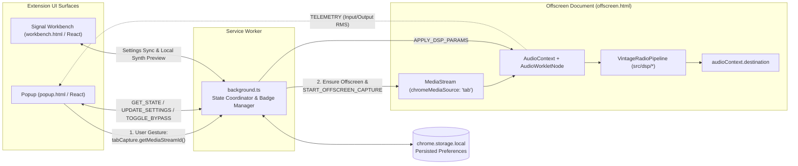

# Technical Decisions, Product Requirements, and Architecture Specification

This document serves as the single source of truth linking our Phase 2 research to implementation across Phases 3–8. It consolidates the **Product Requirements Document (PRD)**, **Technical Architecture Specification**, **Gain Staging & Loudness Calibration Spec**, **Initial Test Plan**, and **Engineering Decision Log**.

---

## 1. Product Requirements Document (PRD)

### 1.1 Product Summary & Target Experience

**Vintage Radio** is a Manifest V3 Chrome extension that transforms audio playing in an active Chrome tab into convincing, musical vintage-radio playback in real time. Rather than muffling audio with a naive low-pass filter and white noise, it models the interaction of broadcast dynamic limiting, nonlinear tube/transistor harmonic excitation, open-back cabinet and paper-cone resonances, channel geometry, and optional signal-following atmospheric static.

### 1.2 Functional Requirements

| ID        | Requirement                             | Acceptance Criteria                                                                                                                                                                                                                         |
| --------- | --------------------------------------- | ------------------------------------------------------------------------------------------------------------------------------------------------------------------------------------------------------------------------------------------- |
| **FR-01** | One-click tab audio activation          | Clicking the primary power toggle in `Popup` captures the active Chrome tab via an explicit user gesture (`chrome.tabCapture.getMediaStreamId`), routes audio through the `offscreen` DSP graph, and maintains continuous audible playback. |
| **FR-02** | Clean stop & native audio recovery      | Clicking Stop (or closing the captured tab / navigating to a restricted `chrome://` page) stops all `MediaStreamTrack`s immediately, restoring Chrome's native unmuted tab output without requiring a page reload.                          |
| **FR-03** | Loudness-matched A/B Bypass             | Users can toggle between **Processed** and **Original (Bypass)** smoothly (25 ms crossfade) with broadband loudness matched within `±1.0 dB` on pink/musical signals.                                                                       |
| **FR-04** | Five scientifically defined presets     | Users can switch live between `Warm Tabletop` (default), `Mid-Century AM`, `Transistor Radio`, `Late-Night Radio`, and `Clean Vintage` with zero clicks or dropouts.                                                                        |
| **FR-05** | Meaningful macro & calibration controls | Every UI control maps 1:1 to real DSP state: `Intensity` (`0–100%`), `Noise Level` (`0–100%`, true `0%` off), `Idle Noise Ducking` (`On/Off`), `Stereo Width` (`Mono 0%` to `Full 100%`), `Tuning Ambience` (`0–100%`), and `Reset Preset`. |
| **FR-06** | Intentional state persistence           | User preferences (selected preset, parameter overrides, idle ducking) persist in `chrome.storage.local`. Transient tab capture state resets cleanly across browser restarts so the UI never falsely claims to be capturing.                 |
| **FR-07** | Contextual status & error recovery      | The UI clearly displays which tab is currently captured, whether audio signal is present, I/O metering, and actionable recovery messages if the active tab cannot be captured (e.g., `chrome://` pages, Chrome Web Store, or silent tabs).  |
| **FR-08** | Strictly local privacy                  | Zero audio recording, zero network requests, zero microphone permission (`permissions: ["tabCapture", "offscreen", "activeTab", "storage"]`).                                                                                               |

### 1.3 Initial Default Sound Profile Decision

Per `HISTORICAL_RADIO_RESEARCH.md` (§4), **Profile B: Warm Vintage Tabletop (`warm-tabletop`)** is selected as the initial out-of-the-box profile (`Intensity: 75%`, `Noise: 18%`, `Idle Ducking: On`). It preserves musical bass fundamentals down to `85 Hz` and vocal clarity up to `5.8 kHz` with gentle `225 Hz` wooden-cabinet warmth and asymmetric tube harmonics, ensuring an inviting, non-fatiguing first impression across modern music, podcasts, and video dialogue.

---

## 2. Technical Architecture Specification

### 2.1 Component Separation (Manifest V3)

### 2.2 Detailed DSP Signal Chain (`src/dsp/pipeline.ts`)

Running inside `VintageRadioProcessor` (`AudioWorkletProcessor`, 128-sample render quantum, zero heap allocations in `process()`):

1. **Input Metering & Envelope Detection:** Computes block RMS/peak and drives the **Idle Noise Ducking** envelope follower (`-55 dBFS` threshold, `600 ms` hold, smooth attack/release).
2. **Channel Width / Mono Matrix (`stereoWidth` smoothed `0.0 → 1.0`):**
   - Decomposes $L, R$ into Mid $M = 0.5(L + R)$ and Side $S = 0.5(L - R)$, then reconstructs $L' = M + w \cdot S$, $R' = M - w \cdot S$ with subtle mid/side power compensation (`1 + 0.12*(1 - w)`) so uncorrelated stereo material does not drop by `-3 dB` when summed toward mono while correlated vocals remain clip-free.
3. **Pre-Filter Low-Order Transformer/Tube Excitation & High-Pass Cascade:**
   - First-stage gentle sub-bass safety trim (`35 Hz` 1st-order HPF) removes DC offset before saturation.
   - Mild pre-speaker nonlinear harmonic generation allows `50–120 Hz` bass notes to generate $2f_0$ and $3f_0$ overtones _before_ steep small-speaker acoustic roll-off (`Winkler et al., 1997`).
   - **Speaker Baffle High-Pass Filter:** 2nd-order (`12 dB/oct`) or cascaded 4th-order (`24 dB/oct`) RBJ Butterworth high-pass filter (`55 Hz` to `360 Hz`, scaled by `Intensity`).
4. **Enclosure & Cone Formant Resonators:**
   - **Biquad Peaking EQ 1 (Cabinet/Cavity Resonance):** Models wooden tabletop warmth (`225 Hz`) or plastic pocket-body boxiness (`1,150 Hz`).
   - **Biquad Peaking EQ 2 (Paper-Cone Presence):** Models `1.95–2.8 kHz` cone breakup / vocal intelligibility lift.
5. **Nonlinear Amplifier Stage (`src/dsp/saturation.ts`):**
   - Selectable transfer curves (`asymmetric-tube`, `soft-tanh`, `germanium-transistor`, `clean-warmth`) with **2× linear oversampling** (zero-delay midpoint interpolation + 2-tap anti-aliasing boxcar decimation) when drive exceeds clean thresholds, suppressing upper-frequency aliasing foldback at negligible CPU cost.
   - Followed immediately by a **15 Hz 1st-order DC Blocker** ($y[n] = x[n] - x[n-1] + R \cdot y[n-1]$, $R = e^{-2\pi \cdot 15 / f_s}$) to strip asymmetric even-harmonic DC offset.
6. **IF Selectivity & Speaker Roll-Off Low-Pass Cascade:**
   - 2nd-order (`12 dB/oct`) or cascaded 4th-order (`24 dB/oct`) RBJ low-pass filter (`3,300 Hz` to `9,200 Hz`, scaled in log-frequency by `Intensity`) taming upper-harmonic intermodulation fizz (`Tan, Moore, & Zacharov, 2003`).
7. **Optional Selective-Fading / Tuning Ambience (`src/dsp/tuning.ts`):**
   - Disabled when `tuning === 0`. When enabled, a slow quadrature LFO (`0.08–0.22 Hz`) modulates a shallow phase-cancellation notch (`700–2,400 Hz`) and subtle RF carrier heterodyne/flutter without warping musical pitch.
8. **Broadcast Program Compressor & Safety Limiter (`src/dsp/compressor.ts`):**
   - Feed-forward RMS/peak program compressor (`1.8:1` to `5:1` ratio) modeling broadcast AGC / output-stage sag, plus a transparent `-0.5 dBFS` soft ceiling safety limiter.
9. **Spectrally Colored Radio Noise Generator (`src/dsp/noise.ts`):**
   - True zero-CPU fast path when `noise === 0`.
   - Combines Paul Kellet's 3-pole Pink Noise filter, Brownian atmospheric rumble, optional AC mains hum (`60 Hz + 120 Hz` harmonics **strictly restricted to AC tube presets**, `0.0` on battery transistor/clean presets), and rare band-limited sferic crackles, shaped through the receiver's speaker passband and modulated by the Idle Noise Ducking envelope.
10. **Calibrated Makeup Gain & Loudness-Matched Dry/Wet Crossfade:**
    - Applies profile-specific calibrated makeup gain scaled by `Intensity`.
    - `Intensity` smoothly interpolates filter cutoffs (in log-Hz), EQ gains, saturation drive, and wet mix, while **Bypass** smoothly ramps master wet/dry mix (`0 ↔ 1`, `25 ms` one-pole time constant) for click-free, loudness-matched A/B comparison.

### 2.3 Parameter Smoothing Strategy

Every continuous DSP target parameter (`wetMix`, `intensity`, `noiseLevel`, `stereoWidth`, `tuningAmount`, `makeupGainLinear`) passes through a per-sample `OnePoleSmoother` (`20–30 ms` time constant). Biquad coefficients are recomputed at control rate (once per 64-sample sub-block when smoothed cutoffs/gains change by `> 1e-4`) using **Direct Form II Transposed** state equations, which remain bounded and click-free under smooth parameter modulation.

---

## 3. Gain Staging & Loudness Calibration Specification

| Stage                       | Nominal Operating Level                                         | Headroom / Protection Rule                                                                                                                                                                       |
| --------------------------- | --------------------------------------------------------------- | ------------------------------------------------------------------------------------------------------------------------------------------------------------------------------------------------ |
| **Dry Input**               | `-18 dBFS` to `-6 dBFS` (typical streaming loudness `-14 LUFS`) | Tolerates up to `+6 dBFS` floating-point Web Audio peaks without NaN/Inf.                                                                                                                        |
| **Formant EQ Boosts**       | `+0.8 dB` to `+4.2 dB` narrowband                               | Preceded by `-2.0 dB` internal pad inside saturation drive calibration to prevent premature hard clipping on hot masters.                                                                        |
| **Waveshaper Stage**        | Normalized unity small-signal slope ($f'(0) = 1$)               | Analytical drive normalization (`1 / drive` scaled with gentle soft-ceiling compensation) keeps output RMS stable across drive settings.                                                         |
| **Per-Profile Makeup Gain** | `+0.4 dB` (`clean-vintage`) to `+3.4 dB` (`transistor-radio`)   | Empirically calibrated against `-16 dBFS` pink noise & multi-tone musical test vectors in `tests/dsp/pipeline.test.ts` so Processed RMS matches Dry RMS within `±1.0 dB` at default `Intensity`. |
| **Final Safety Ceiling**    | `-0.3 dBFS` (`0.966` linear)                                    | Soft-knee tanh safety ceiling prevents digital `> 0 dBFS` DAC clipping even under extreme parameter combinations (`Intensity: 100%`, hot `+6 dBFS` input).                                       |

---

## 4. Initial Verification & Test Plan

1. **Automated Unit & DSP Signal Tests (`Vitest` — `tests/dsp/*.test.ts`, `tests/state/*.test.ts`):**
   - **Biquad Filter Accuracy:** Verify passband unity gain (`0 dB ± 0.1 dB`), `-3 dB` cutoff accuracy at `44.1 kHz`, `48 kHz`, and `96 kHz`, stopband attenuation slope, Nyquist clamping safety, and impulse stability.
   - **Nonlinear Waveshapers & DC Blocker:** Verify odd vs. even harmonic generation via DFT on `1 kHz` sine wave, verify `< 1e-3` residual DC offset after asymmetric tube stage, verify bounded output (`<= 1.0`) for `+6 dBFS` (`amplitude = 2.0`) hot inputs.
   - **Full Pipeline Synthetic Suite:** Test across (a) `60 Hz`, `250 Hz`, `1 kHz`, `8 kHz` sine waves, (b) logarithmic `20 Hz–20 kHz` sweep, (c) unit impulse, (d) digital silence, (e) white & pink noise, (f) mono & out-of-phase stereo signals, (g) `-60 dBFS` quiet & `+6 dBFS` hot signals, (h) rapid mid-stream preset switching & bypass toggling (asserting absence of click discontinuities), (i) loudness-matched bypass (`±1.0 dB` RMS on pink/music composite), (j) true zero-noise silence (`RMS === 0` after tail decay when `noise = 0` on silent input), (k) Idle Noise Ducking attenuation when signal stops, and (l) `60-second` continuous playback stability & real-time CPU execution speed (`> 50×` faster than real-time on test hardware).
2. **Automated Browser & Extension E2E Verification (`Playwright` — `tests/e2e/extension.spec.ts`):**
   - Verify `Popup` rendering at exact Chrome popup viewport (`380×560`), keyboard accessibility, ARIA states, contrast compliance, preset selection, bypass shortcut, and Calibration drawer.
   - Verify `Signal Workbench` (`workbench.html`) interactive Web Audio synthesizer + live `AudioWorklet` / `VintageRadioPipeline` auditioning and frequency-response curve updates.
   - Launch real Chromium/Chrome with `--disable-extensions-except=dist --load-extension=dist` to verify Manifest V3 service worker registration, extension popup execution, storage persistence, and error-free console logs.

---

## 5. Engineering Decision Log

| Date         | Decision                                                                                                                  | Alternatives Considered                                                                | Rationale                                                                                                                                                                                                                                                                                                                                        |
| ------------ | ------------------------------------------------------------------------------------------------------------------------- | -------------------------------------------------------------------------------------- | ------------------------------------------------------------------------------------------------------------------------------------------------------------------------------------------------------------------------------------------------------------------------------------------------------------------------------------------------ |
| `2026-11-01` | **Pure TypeScript DSP core (`src/dsp/`) shared by `AudioWorkletProcessor`, `Workbench`, and `Vitest`**                    | Native Web Audio `BiquadFilterNode` + `WaveShaperNode` graph only                      | Native DOM nodes cannot run inside Node/Vitest without mocking the entire Web Audio engine (leaving actual DSP untested) and cannot do sample-accurate envelope-ducked noise or oversampled asymmetric tube saturation cleanly. Pure TS inside `AudioWorklet` runs off the UI thread _and_ enables 100% deterministic mathematical unit testing. |
| `2026-11-01` | **Invoke `chrome.tabCapture.getMediaStreamId` in `Popup` click handler, consume in `Offscreen` document**                 | Content-script `MediaElementAudioSourceNode` or Service Worker-only `getMediaStreamId` | Content scripts break on cross-origin media streams (CORS silence) and require invasive `<all_urls>` permissions. Calling `getMediaStreamId` directly inside the user-gesture `Popup` handler reliably inherits `activeTab` activation in Chrome MV3.                                                                                            |
| `2026-11-01` | **Include `Signal Workbench` (`workbench.html`) alongside `Popup`**                                                       | `Popup` only                                                                           | Satisfies §6 ("consider a separate extension page for advanced controls, measurements, and research information") and lets users/testers audition presets immediately on built-in synthetic speech/music signals even without opening an external streaming site.                                                                                |
| `2026-11-01` | **Warm Braun/Dieter Rams industrial palette (`#F5F2EB` surface, `#1C1A17` ink, `#B85D19` amber, `#2A6049` signal green)** | Dark mode neon EQ or wood-grain skeuomorphism                                          | Directly fulfills §6 visual direction ("Warm neutral surfaces, deep charcoal text, restrained amber or muted green accents... Do not automatically turn the interface into a skeuomorphic radio dashboard").                                                                                                                                     |
